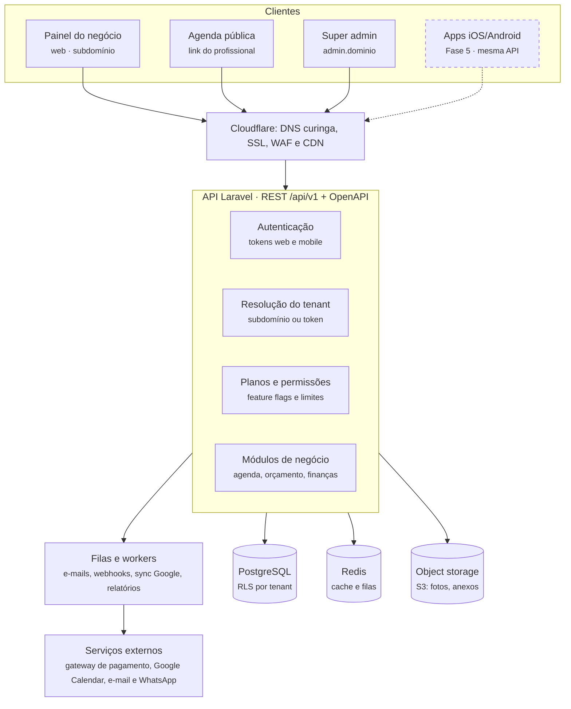

# 03 · Arquitetura

Uma única API REST versionada atende todos os clientes: painel web, página pública de agendamento, super admin e, depois, os apps. O painel web não acessa o banco por outro caminho, então o que funciona na web já funciona para o mobile.

O tracejado marca o que fica para depois; a caixa da API é o núcleo que precisa existir desde a Fase 1.

## Decisões de arquitetura

- **API-first com contrato OpenAPI.** O contrato é escrito na especificação de cada funcionalidade antes do código. Dele sai um cliente TypeScript tipado, usado pela web e depois pelo app.
- **Versionamento** em `/api/v1`. Mudança que quebra contrato só em `/v2`, para não derrubar apps antigos que ainda estão nas lojas.
- **Multi-tenant em banco compartilhado.** Toda tabela de negócio tem `tenant_id`, e o PostgreSQL aplica Row Level Security como segunda barreira, além do filtro na aplicação. Escala para milhares de tenants sem migrar milhares de bancos. (ADR [0002](arquitetura/adr/0002-multi-tenant.md))
- **Resolução do tenant.** Na web, pelo subdomínio (`estudio.dominio`). No app, o login devolve um token ligado ao usuário e ao tenant. Domínio próprio do cliente fica para um plano superior.
- **Autenticação.** Sessão com cookie para a web e token para o mobile, no mesmo provedor. 2FA para donos e super admin.
- **Padrões de API para mobile:** paginação por cursor, `Idempotency-Key` em criação de agendamento e pagamento, datas em ISO 8601 com UTC no banco e fuso do tenant na exibição, erros no formato RFC 9457 (Problem Details).
- **Trabalho pesado em filas**: e-mails, notificações, webhooks de pagamento, sincronização com o Google Calendar e relatórios.
- **Eventos de domínio** (agendamento criado, orçamento aprovado, assinatura vencida) disparam notificações, auditoria e integrações, sem acoplar os módulos.
- **Monólito modular**: um repositório de API com módulos isolados (Plataforma, Agenda, Orçamento, Financeiro, Clientes). Microserviços só se algum módulo provar que precisa.
