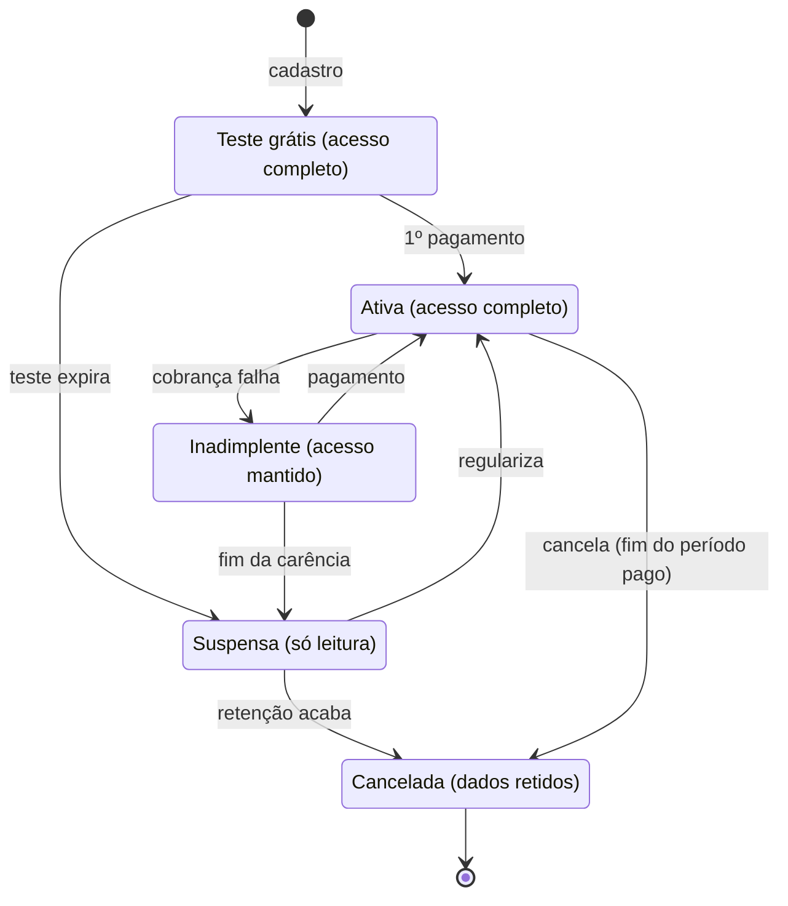

# 05 · Planos, assinaturas e funcionalidades por plano

O que cada assinante pode usar é decidido por um serviço de *entitlements* na API, nunca só escondendo botão na tela. O plano liga funcionalidades (sim/não) e limites (quantidade), e o super admin pode conceder exceções por assinante.

## Modelo

- `features`: catálogo de chaves, por exemplo `agenda.publica`, `integracao.google_calendar`, `orcamento`, `relatorios.exportar`, `usuarios.max`.
- `plans` e `plan_features`: cada plano define o valor de cada chave (`true`/`false` ou um número).
- `tenant_feature_overrides`: exceções dadas pelo super admin (cortesia, add-on, piloto).
- Na API, um middleware `feature:integracao.google_calendar` devolve 403 com código `feature_not_in_plan`. A web e o app leem `GET /api/v1/me/entitlements` para mostrar o que está liberado e oferecer upgrade.

## Planos iniciais (nomes, preços e limites provisórios)

| Plano | Usuários | Inclui |
| --- | --- | --- |
| Essencial | 1 | Agenda, clientes, atendimentos, despesas, dashboard |
| Profissional | até 5 | Tudo do Essencial + orçamentos, agenda pública, integração Google Calendar, relatórios e exportação |
| Estúdio | a definir | Tudo do Profissional + vários profissionais com agendas próprias, comissões, domínio próprio |

O Tatulog cobrava R$ 14,90 e R$ 39,90 por mês; os novos preços entram nas [decisões em aberto](14-decisoes-em-aberto.md). Ciclos mensal e anual, com desconto no anual.

## Ciclo de vida da assinatura

O teste grátis e o cancelamento mantêm o acesso até o fim do período; só a suspensão bloqueia escrita, e os dados ficam retidos por um prazo definido na política de privacidade antes da exclusão.

## Cobrança recorrente

- Gateway atrás de uma interface própria (`BillingGateway`), para trocar de fornecedor sem mexer no domínio. Candidatos a avaliar: Asaas, Pagar.me, Iugu, Mercado Pago e Stripe, comparando cartão recorrente, Pix Automático, boleto, taxas, nota fiscal e qualidade dos webhooks.
- O sistema nunca vê nem guarda número de cartão: checkout e tokenização ficam no gateway.
- Webhooks verificados por assinatura, gravados antes de processar e processados de forma idempotente em fila. Um job diário reconcilia o estado local com o gateway.
- Upgrade imediato com cobrança proporcional; downgrade no próximo ciclo, com aviso se o assinante passar de algum limite.
- E-mails de cobrança: boas-vindas, fim do teste chegando, pagamento aprovado, falha de pagamento, suspensão e cancelamento.
