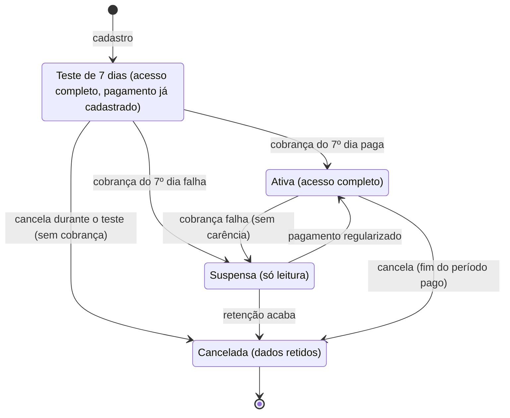

# 05 · Planos, assinaturas e funcionalidades por plano

O que cada assinante pode usar é decidido por um serviço de *entitlements* na API, nunca só escondendo botão na tela. O plano liga funcionalidades (sim/não) e limites (quantidade), e o super admin pode conceder exceções por assinante.

## Modelo

- `features`: catálogo de chaves, por exemplo `agenda.publica`, `integracao.google_calendar`, `orcamento`, `relatorios.exportar`, `usuarios.max`.
- `plans` e `plan_features`: cada plano define o valor de cada chave (`true`/`false` ou um número).
- `tenant_feature_overrides`: exceções dadas pelo super admin (cortesia, add-on, piloto).
- Na API, um middleware `feature:integracao.google_calendar` devolve 403 com código `feature_not_in_plan`. A web e o app leem `GET /api/v1/me/entitlements` para mostrar o que está liberado e oferecer upgrade.

## Decisões de negócio (Gustavo, 2026-10-22)

- **Planos de lançamento:** três planos: Essencial, Profissional e Estúdio. Preços, limites e o que cada um inclui **ainda não estão definidos**; o sistema nasce sem regra fixa e o catálogo é configurável.
- **Teste grátis:** 7 dias.
- **Ciclos:** mensal ou anual. O anual tem desconto (percentual por plano, a definir).
- **Funcionalidades por plano:** cada funcionalidade pode estar **liberada, limitada (com número) ou oculta** conforme o plano. O modelo já prevê as três situações; as regras de cada plano entram depois, sem mudar código (só dados do catálogo).
- **Assinatura de cortesia (teste interno):** é possível assinar sem pagar, por **cupom de desconto** de 100% (cortesia) ou proporcional. O cupom é do nosso domínio (o gateway não o fornece para assinaturas): ele define o valor que será cobrado.
- **Cancelamento:** em até 7 dias sem custo, conforme o direito de arrependimento do Código de Defesa do Consumidor (art. 49). Os 7 dias contam **a partir do momento em que o cliente solicita e libera a assinatura**, que coincide com o período de teste: cancelar durante o teste nunca gera cobrança, e a primeira cobrança só ocorre depois dele. Não há estorno automático depois da primeira cobrança; o cancelamento então vale até o fim do período já pago. (Decisão de Gustavo em 2026-10-22; vale revisão jurídica antes do lançamento.)
- **Meios de pagamento:** Pix e cartão de crédito, com recorrência automática no cartão.

## Decisões de negócio, segunda rodada (Gustavo, 2026-10-24)

- **Preços iniciais (mensal):** Essencial R$ 15,00, Profissional R$ 50,00 e Estúdio R$ 250,00. **Desconto de 10%** no plano anual.
- **Teste de 7 dias exige meio de pagamento já cadastrado.** Para iniciar o teste, o cliente informa e autoriza o pagamento; a cobrança só ocorre no 7º dia, se ele não tiver cancelado.
- **Falha no pagamento = acesso suspenso na mesma hora.** Não há carência. Isto vale para a primeira cobrança e para as seguintes.
- **Cupons:** criados pelo super admin, com **período de validade** e **limite de usos**.
- **Meio de pagamento por último.** Por enquanto o fluxo roda com um meio de pagamento de teste (simulado) atrás de uma interface própria; o gateway real (Asaas) entra no fim, quando a conta existir.
- **Nichos do primeiro teste:** tatuagem, manicure, barbeiro e estética automotiva.
- **Migração do Tatulog:** fora do escopo por ora (há apenas 1 assinatura).
- **Nome do produto e domínio:** ainda indefinidos; continuam em configuração. Cores e logo: sugestão do time de desenvolvimento (ver design system).

## Modelo de funcionalidades por plano

`plan_features` guarda, para cada par plano × funcionalidade: `enabled` (liberada ou não), `limit` (número, ou vazio para ilimitado) e `visible` (se a funcionalidade aparece na interface mesmo quando bloqueada, para oferecer upgrade, ou fica oculta). O serviço de entitlements devolve esse resultado e a interface apenas o reflete.

## Planos iniciais (nomes, preços e limites provisórios)

| Plano | Usuários | Inclui |
| --- | --- | --- |
| Essencial | 1 | Agenda, clientes, atendimentos, despesas, dashboard |
| Profissional | até 5 | Tudo do Essencial + orçamentos, agenda pública, integração Google Calendar, relatórios e exportação |
| Estúdio | a definir | Tudo do Profissional + vários profissionais com agendas próprias, comissões, domínio próprio |

O Tatulog cobrava R$ 14,90 e R$ 39,90 por mês; os novos preços entram nas [decisões em aberto](14-decisoes-em-aberto.md). Ciclos mensal e anual, com desconto no anual.

## Ciclo de vida da assinatura

O teste e o cancelamento mantêm o acesso até o fim do período; só a suspensão bloqueia escrita (acesso só de leitura). A falha de cobrança suspende na mesma hora. Os dados ficam retidos por um prazo (a definir na política de privacidade) antes da exclusão.

## Cobrança recorrente

- Gateway atrás de uma interface própria (`BillingGateway`), para trocar de fornecedor sem mexer no domínio. Candidatos a avaliar: Asaas, Pagar.me, Iugu, Mercado Pago e Stripe, comparando cartão recorrente, Pix Automático, boleto, taxas, nota fiscal e qualidade dos webhooks.
- O sistema nunca vê nem guarda número de cartão: checkout e tokenização ficam no gateway.
- Webhooks verificados por assinatura, gravados antes de processar e processados de forma idempotente em fila. Um job diário reconcilia o estado local com o gateway.
- Upgrade imediato com cobrança proporcional; downgrade no próximo ciclo, com aviso se o assinante passar de algum limite.
- E-mails de cobrança: boas-vindas, fim do teste chegando, pagamento aprovado, falha de pagamento, suspensão e cancelamento.
