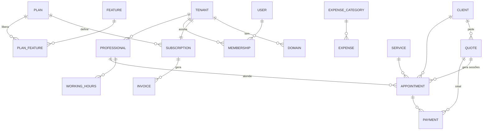

# 07 · Modelo de domínio

O modelo troca o "atendimento de tatuagem" por três peças genéricas: **serviço** (o que se oferece), **orçamento** (o combinado para um cliente) e **agendamento** (o horário reservado). Assim o mesmo núcleo serve a tatuador, trancista ou manicure; o nicho só muda presets e vocabulário. Nomes de entidades são provisórios e ficam no [glossário](glossario.md).

## Plataforma (sem `tenant_id`)

| Entidade | Para que serve | Campos principais |
| --- | --- | --- |
| Tenant | O negócio assinante | nome, slug do subdomínio, nicho, fuso, moeda, status |
| Domain | Subdomínio e, depois, domínio próprio | host, tenant, verificado |
| Plan, Feature, PlanFeature | Catálogo de planos e o que cada um libera | chave, tipo (bool/limite), valor, preço mensal/anual |
| Subscription, Invoice | Assinatura e faturas | plano, ciclo, status, id no gateway, vencimento, valor |
| BillingEvent | Webhooks do gateway, gravados antes de processar | id externo (único), payload, processado em |
| PlatformUser, Lead | Equipe da plataforma e leads da landing | papel, 2FA; UTM, origem |

## Assinante (toda tabela com `tenant_id` + RLS)

| Entidade | Para que serve | Campos principais |
| --- | --- | --- |
| User, Membership | Pessoa e seu papel em cada assinante | e-mail, papel, ativo |
| Professional | Quem tem agenda (pode ser o próprio dono) | usuário, cor, % de comissão padrão |
| Service, ServiceCategory | Catálogo do que é oferecido | duração padrão (min), preço base ou "sob orçamento", intervalo antes/depois, exige sinal |
| WorkingHours, TimeOff | Expediente e bloqueios | dia da semana, início, fim; folgas, férias, feriados |
| Client | Cliente final | nome, telefone E.164 (único por tenant), e-mail, Instagram, consentimento LGPD |
| Quote | Orçamento | cliente, serviços, descrição, fotos de referência, duração estimada, nº de sessões, valor, sinal, validade, status |
| Appointment | Horário reservado | profissional, cliente, serviço, orçamento, início e fim, sessão n de m, status, origem (painel, link público, app) |
| Payment | Dinheiro recebido | agendamento/orçamento, tipo (sinal, parcela, final), forma, valor, status |
| Expense, ExpenseCategory | Despesas | valor, data, status, categoria |
| Attachment | Arquivos | referência, arte aprovada, resultado; dono do arquivo |
| AuditLog | Quem mudou o quê | entidade, ação, antes, depois, usuário, IP |
| Setting | Preferências do negócio | meta do mês, vocabulário do nicho, regras de agenda pública |

## Regras centrais

- Horários gravados em UTC; exibidos no fuso do assinante. Duração em minutos.
- Dois agendamentos do mesmo profissional não se sobrepõem: checado na API e garantido no banco por constraint de exclusão do PostgreSQL.
- Um horário livre = expediente − bloqueios − agendamentos − intervalos do serviço.
- Orçamento aprovado gera um ou mais agendamentos (um por sessão) e, se houver, a cobrança do sinal.
- Receita prevista, recebida e líquida são calculadas a partir de `Payment`, não do valor total do agendamento.
