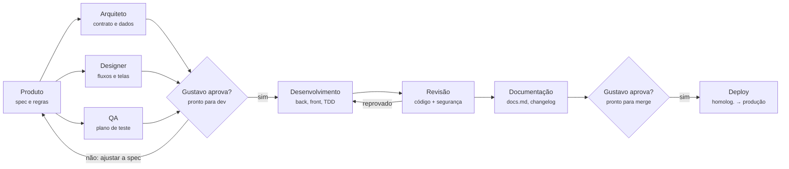

# 10 · Fluxo de agentes

O fluxo recomendado é "especificar e testar antes de codar": agentes de produto, arquitetura, design e QA preparam cada funcionalidade em paralelo, Gustavo aprova, e só então os agentes de desenvolvimento implementam até os testes ficarem verdes. Revisão e documentação fecham o ciclo antes da segunda aprovação.

O QA escreve os testes antes do código, então o desenvolvimento começa com uma suíte falhando e termina quando ela passa. Uma revisão reprovada volta para o desenvolvimento, nunca para o merge.

| Agente | Arquivo | Responsabilidade | Entrega | Não pode |
| --- | --- | --- | --- | --- |
| Produto | `.claude/agents/produto.md` | Transformar item do backlog em especificação; manter glossário e escopo | `spec.md` | Escrever código |
| Arquiteto | `.claude/agents/arquiteto.md` | Contrato de API, modelo de dados, impactos em multi-tenant e mobile; ADRs | `openapi.yaml`, seção de dados da spec, ADR | Implementar funcionalidade |
| Designer UX/UI | `.claude/agents/designer.md` | Fluxos, telas, estados vazios e de erro, design system | Telas, tokens | Mudar regra de negócio |
| QA | `.claude/agents/qa.md` | Plano de teste a partir dos critérios de aceite; esqueleto dos testes falhando | `test-plan.md` + testes | Alterar teste para passar |
| Dev back-end | `.claude/agents/dev-backend.md` | API, regras, migrations, filas, seguindo o contrato | Código + testes verdes | Mudar contrato sem o Arquiteto |
| Dev front-end | `.claude/agents/dev-frontend.md` | Telas web consumindo o cliente gerado | Código + testes verdes | Chamar API fora do cliente gerado |
| Revisor | `.claude/agents/revisor.md` | Qualidade, legibilidade, aderência à spec | Comentários no PR | Aprovar com CI vermelho |
| Segurança | `.claude/agents/seguranca.md` | Isolamento de tenant, OWASP, LGPD, segredos | Parecer no PR | Editar código |
| Documentação | `.claude/agents/documentacao.md` | Guia de uso, changelog, ajuda no produto | `docs.md`, changelog | Mudar comportamento |

DevOps (`.claude/agents/devops.md`) entra como agente de apoio nas Fases 0 e 1 e quando a infraestrutura muda; Dev mobile entra na Fase 5.

## Como funciona no Claude Code

- Um arquivo por agente em `.claude/agents/<nome>.md`, com papel, ferramentas permitidas e a skill que ele deve usar. Agentes de revisão e segurança só leem; não editam código.
- `CLAUDE.md` na raiz com comandos, arquitetura, convenções e a regra de ouro: sem spec aprovada, sem código.
- Cada funcionalidade vira uma issue no GitHub com ID (`PLT-003`), um branch e um PR que referencia a spec; o status da issue segue o fluxo acima.
