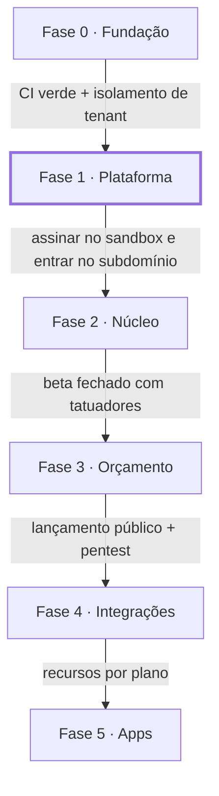

# 12 · Roadmap por fases

A ordem segue o pedido: primeiro a fundação e a plataforma de assinatura (super admin, cadastro, cobrança, subdomínio, usuários), depois o núcleo herdado do Tatulog, e só então orçamento, integrações e apps.

| Fase | Escopo | Critério para avançar |
| --- | --- | --- |
| **0 · Fundação** | ADRs, monorepo, CI/CD, homologação, agentes, skills, design system base | CI verde com o teste de isolamento de tenant |
| **1 · Plataforma** (foco atual) | Super admin, cadastro, planos, assinatura, subdomínio, usuários, papéis, faturas | Assinar no sandbox e entrar no subdomínio |
| **2 · Núcleo** | Clientes, serviços, expediente, agenda, atendimentos, despesas, dashboard | Beta fechado com tatuadores |
| **3 · Orçamento** | Orçamento → agendamento, sinal, agenda pública, migração dos dados do Tatulog | Lançamento público com pentest aprovado |
| **4 · Integrações** | Google Calendar, lembretes por e-mail e WhatsApp, relatórios e exportação | Recursos liberados conforme o plano |
| **5 · Apps** | iOS e Android com Expo sobre a mesma API, notificações push | Apps publicados nas lojas |

As fases não têm datas ainda: a estimativa sai ao fim da Fase 0, quando as specs da Fase 1 estiverem escritas e dimensionadas.
