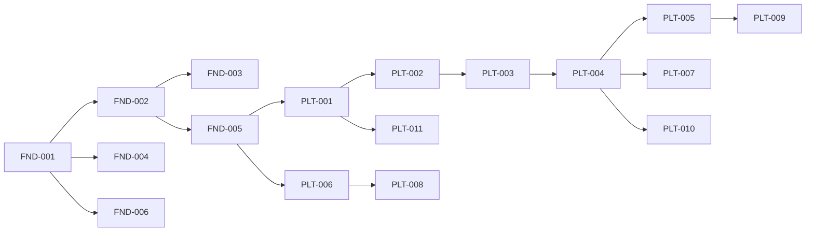

# 13 · Backlog inicial (Fases 0 e 1)

São 17 itens; cada um vira uma pasta em `docs/funcionalidades/<ID>-<slug>/` com spec, documentação e plano de teste antes de qualquer código. A Fase 0 entrega documentos, padrões e infraestrutura; a Fase 1 entrega a plataforma de assinatura.

Status possíveis: `A especificar` → `Spec em revisão` → `Pronto para dev` → `Em desenvolvimento` → `Entregue`.

| ID | Item | Depende de | Teste crítico | Status |
| --- | --- | --- | --- | --- |
| FND-001 | ADRs: stack, multi-tenant (RLS), gateway de pagamento, hospedagem | — | — | Em andamento (falta ADR 0003, gateway) |
| FND-002 | Monorepo, `CLAUDE.md`, agentes e skills iniciais | FND-001 | Lint e testes rodando localmente e em container (o CI os executa no FND-003) | Entregue |
| FND-003 | CI: lint, análise estática, testes, contrato e auditoria de dependências (deploy em homologação virou FND-007) | FND-002 | Pipeline falha com estilo, lint ou contrato quebrado; bloqueio de merge depende da proteção de branch | Entregue |
| FND-004 | Infra de homologação em Docker Compose (API, workers, Postgres, Redis, armazenamento de objetos, e-mail) + Cloudflare com curinga; backup e restauração ensaiados (ADR 0004). Terraform/AWS fica para depois | FND-001 | Deploy e rollback ensaiados | A especificar |
| FND-005 | Base multi-tenant: resolução por subdomínio e token, RLS, suíte de isolamento | FND-002 | Tenant A não acessa dado do tenant B | Entregue |
| FND-006 | Design system base (tokens, componentes, layout do painel) | FND-001 | Componentes com testes de acessibilidade | Entregue |
| FND-007 | Deploy em homologação com Docker Compose no servidor escolhido (inclui backup/restauração e Cloudflare) | FND-003, FND-004 | Deploy e rollback ensaiados | Adiado (primeiro roda só local; ADR 0004) |
| PLT-001 | Login do super admin com 2FA (API); o painel web vira PLT-001b | FND-005 | Rota de plataforma inacessível a usuário de tenant | Entregue (API) |
| PLT-001b | Painel web do super admin (login, 2FA e navegação) consumindo a API do PLT-001 | PLT-001, FND-006 | Rota de plataforma inacessível a usuário de tenant | Entregue |
| PLT-002 | Catálogo de planos e funcionalidades (entitlements) gerido pelo super admin | PLT-001 | Funcionalidade fora do plano devolve 403 | Entregue |
| PLT-003 | Cadastro self-service (API): dados do negócio, subdomínio, nicho, plano, pagamento de teste e 7 dias de teste | PLT-002 | Subdomínio único e reservado; provisionamento idempotente | Entregue (API) |
| PLT-004 | Cobrança do fim do teste e das renovações com meio de pagamento de teste; suspensão imediata em falha (`billing:run`) | PLT-003 | Rodar duas vezes não cobra duas vezes; falha suspende na hora | Entregue (API) |
| PLT-005 | Bloqueio de acesso por status (somente leitura quando suspensa ou cancelada) e `GET /subscription` | PLT-004 | Suspensa = só leitura; liberar na hora ao regularizar (a regularização é do PLT-007) | Entregue (API) |
| PLT-006 | Autenticação do assinante (web e token mobile), recuperação de senha, 2FA do dono | FND-005 | Token de um tenant não vale em outro | Entregue (API) |
| PLT-007 | Gestão da assinatura pela dona: forma de pagamento, regularização, faturas, cancelamento | PLT-004 | Suspensa regulariza com novo cartão e volta na hora; cancelamento sem cobrança (troca de plano foi para o PLT-013) | Entregue (API) |
| PLT-008 | Usuários e papéis do assinante: convite, papéis, desativação, limite do plano | PLT-006 | Cada papel só acessa o que a matriz permite | Entregue (API) |
| PLT-009 | Gestão de assinantes no super admin: lista, detalhe, exceções, suspender, impersonação auditada | PLT-005 | Impersonação sempre registrada | Entregue (API) |
| PLT-010 | E-mails transacionais da plataforma (boas-vindas, teste acabando, cobrança, suspensão) | PLT-004 | Cada evento dispara um e-mail, uma vez | Entregue |
| PLT-011 | Landing, leads com UTM e reCAPTCHA, tela de leads no super admin | PLT-001 | Lead inválido ou sem captcha rejeitado | Entregue (API) |
| PLT-012 | Cupons e assinaturas de cortesia: cupom de 100% ou proporcional, criado pelo super admin, com validade e limite de uso | PLT-002, PLT-003 | Cupom de 100% assina sem cobrança; proporcional reduz o valor | Entregue (API) |
| PLT-013 | Troca de plano: upgrade imediato com cobrança proporcional, downgrade no próximo ciclo com aviso de limite | PLT-007, PLT-002 | Downgrade acima do limite é bloqueado com aviso (depende das regras de limite por plano, ainda não definidas) | Entregue |
| PLT-014 | Site público: landing com planos e formulário de contato (leads) e cadastro do assinante (plano, ciclo, cupom, pagamento de teste) | FND-006, PLT-003, PLT-011, PLT-012 | Cadastro completo chega ao painel do assinante; lead sem captcha é recusado | Entregue (cadastro e site; o painel do assinante é o PLT-015) |
| PLT-015 | Painel web do assinante: entrar (2FA), recuperar senha, aceitar convite, início, assinatura (cartão, cancelar, faturas) e equipe | FND-006, PLT-006, PLT-007, PLT-008 | Suspenso só lê e consegue regularizar; papel sem permissão não vê a tela | Entregue |
| INT-001 | Gateway real de pagamento (Asaas): checkout, webhooks, conciliação, nota fiscal e reserva da fatura em estado `pending` antes de cobrar (cobrança fora da transação) | PLT-004, ADR 0003 | Webhook repetido não duplica cobrança; ciclo de vida completo no sandbox | A especificar (por último, depende da conta do Asaas) |

