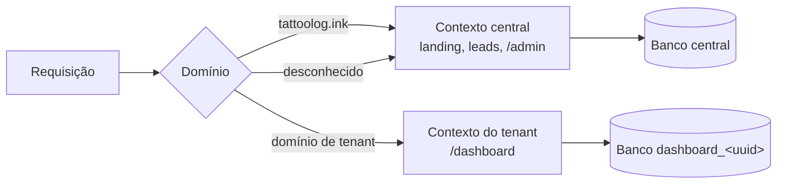

# TattooLog — Especificação Funcional para Reconstrução

> Referência do sistema **atual** (Tatulog), escrita em 15/10/2026. Serve para entender as regras herdadas e para a migração de dados. O que muda no sistema-log está em [../02-heranca-tatulog.md](../02-heranca-tatulog.md).

## Visão geral

O TattooLog é um SaaS multi-tenant para tatuadores gerenciarem clientes, atendimentos (agendamentos), despesas e o balanço financeiro mensal. Cada estúdio/tatuador é um tenant com domínio e banco de dados próprios. Esta especificação descreve o comportamento atual (Laravel 11 + Filament 3 + stancl/tenancy).

- **Público:** tatuadores autônomos e pequenos estúdios no Brasil.
- **Idioma e região:** interface em pt-BR, fuso America/Sao_Paulo, moeda BRL, telefone com DDI (padrão +55).
- **Domínio de produção:** tattoolog.ink (área central). Tenants acessam pelo próprio domínio.

## Arquitetura multi-tenant

O sistema tem dois contextos separados pelo domínio da requisição, e cada tenant tem um banco de dados próprio. Os tenants não compartilham tabelas e não há coluna `tenant_id`.

- **Contexto central** (`tattoolog.ink`, `localhost` em dev): landing, leads e painel `/admin`, usando o banco central.
- **Contexto do tenant** (domínio cadastrado em `domains`): painel `/dashboard`, usando o banco `dashboard_<uuid>`. Nenhum dado de negócio fica no banco central.
- O domínio central não acessa `/dashboard`. Um domínio que não é de nenhum tenant redireciona para o central.

## Modelo de dados

São 5 entidades de negócio por tenant (User, Client, Appointment, Expense, ExpenseCategory) e 4 entidades centrais (Tenant, Domain, User admin, Lead). Todas têm `id`, `created_at` e `updated_at`, exceto onde indicado. Valores monetários são `decimal(8,2)` em BRL.

### Banco central

| Entidade | Campo | Tipo | Regras |
| --- | --- | --- | --- |
| Tenant | id | string (UUID) | Chave primária gerada automaticamente |
| Tenant | name | string | Obrigatório |
| Tenant | email | string | Obrigatório, único |
| Tenant | password | string | Obrigatório, salvo com hash |
| Tenant | data | json | Atributos extras livres |
| Domain | domain | string(255) | Único; FK tenant_id com cascade |
| User (admin) | name, email, password | string | email único; senha com hash |
| Lead | name | string | Obrigatório, máx. 120 |
| Lead | email | string | Obrigatório, máx. 150, indexado |
| Lead | phone, company | string | Opcionais (máx. 50 / 120) |
| Lead | message | text | Opcional, máx. 2000 |
| Lead | source | string | Padrão `landing` |
| Lead | utm | json | utm_source, utm_medium, utm_campaign, utm_term, utm_content |
| Settings | general.monthly_goal | float | Meta mensal, padrão 0.0 (ainda não usada) |

### Banco de cada tenant

| Entidade | Campo | Tipo | Regras |
| --- | --- | --- | --- |
| User | name, email, password | string | email único; senha com hash; email_verified_at opcional |
| Client | name | string | Opcional |
| Client | email | string | Opcional; salvo em minúsculas e sem espaços; único (validação de formulário) |
| Client | ddi | string(4) | Obrigatório no formulário, padrão `55`, só dígitos (sem `+`) |
| Client | phone | string | Obrigatório, único no banco, só dígitos; máscara `(99) 99999 9999` |
| Client | instagram | string | Opcional, único |
| Client | notes | longtext | Opcional |
| Appointment | client_id | FK Client | Obrigatório |
| Appointment | description | string(255) | Opcional |
| Appointment | status | enum | pending, scheduled, rescheduled, completed, cancelled, other; padrão pending |
| Appointment | type | string | appointment (Atendimento) ou retouching (Retoque); padrão appointment |
| Appointment | categories | string | Texto livre |
| Appointment | date | timestamp | Data e hora, sem segundos |
| Appointment | duration | string | Inteiro em horas |
| Appointment | value_total | decimal | Valor total |
| Appointment | value_input | decimal | Valor do sinal (entrada) |
| Appointment | value_commission | decimal | Valor da comissão |
| Appointment | payment_status | enum | pending, entry, paid, exchange, other; padrão pending |
| Appointment | payment_type | string | credit, debit, money, pix, other |
| Appointment | client_review | tinyint | 1 a 5 estrelas, opcional |
| Appointment | notes | longtext | Opcional |
| ExpenseCategory | name | text | — |
| Expense | name | string | Opcional |
| Expense | category_id | FK ExpenseCategory | Obrigatório no formulário; excluir a categoria exclui as despesas (cascade) |
| Expense | status | enum | pending, paid; padrão pending |
| Expense | date | timestamp | Usado só como data (sem hora) |
| Expense | value_total | decimal | Valor |
| Expense | notes | longtext | Opcional |

### Relacionamentos e rótulos

- Tenant 1–N Domain. Client 1–N Appointment. ExpenseCategory 1–N Expense.
- Rótulos pt-BR dos enums: Pendente, Agendado, Reagendado, Finalizado, Cancelado, Outro, Entrada, Pago, Permuta. Pagamento: Cartão de Crédito, Cartão de Débito, Dinheiro, PIX, Outro.
- Campos de imagem previstos e comentados no código: `image_approved_art` (arte aprovada) e `image_finished_tattoo` (tatuagem finalizada).

## Regras de negócio por módulo

Todos os módulos do painel do tenant têm listagem, criação, edição, exclusão (individual e em lote) e histórico de alterações. Após criar ou editar, o usuário volta para a listagem.

### Atendimentos (Appointments)

- **Cliente obrigatório**, escolhido por busca. A opção mostra `Nome - Telefone`.
- **Criação rápida de cliente** dentro do formulário, com nome, DDI e telefone obrigatórios:
  1. Normaliza DDI e telefone para só dígitos.
  2. Se já existe cliente com o mesmo DDI e telefone (comparando também o telefone sem formatação), seleciona o existente e avisa: "Cliente já existe".
  3. Senão, cria o cliente e avisa: "Cliente criado".
  4. Se a criação falhar por duplicidade concorrente, busca de novo e seleciona o existente.
- **Formulário em blocos:** cliente; descrição, status, tipo, categorias; data/hora e duração (horas); valores (total, sinal, comissão); pagamento (status e forma); avaliação do cliente (1–5) e notas.
- **Listagem:**
  - Coluna principal: descrição em negrito + `cliente - +DDI telefone`.
  - Status editável direto na linha (select).
  - Data no formato `dd/mm/aaaa HH:mm`; ordenação padrão por data decrescente.
  - Valores em BRL com soma no rodapé (total sempre visível; sinal e comissão ocultáveis).
  - Cores do status de pagamento: Pendente = vermelho, Entrada = amarelo, Pago = verde, Permuta/Outro = cinza.
  - Cores da avaliação: ≥ 4,5 verde, = 3 amarelo, < 3 vermelho.
- **Abas de período com contador:** Tudo, Essa semana, Esse mês, Próximo mês, Esse ano (pelo campo `date`).
- **Filtros:** cliente; status (múltiplo); status de pagamento (múltiplo). **Agrupamentos:** status, tipo, data, status de pagamento.
- **Busca global:** descrição, notas, nome do cliente.

### Clientes

- Campos: nome, e-mail, DDI (só +55 por enquanto), telefone (obrigatório), Instagram, notas.
- **Unicidade:** telefone (banco), e-mail e Instagram (formulário). E-mail salvo em minúsculas, sem espaços.
- **Listagem:** nome, quantidade de atendimentos ("Atds."), média de avaliações (2 casas, mesmas cores dos atendimentos), telefone copiável. Ordem padrão por nome.
- **Média de avaliação** = média de `client_review` dos atendimentos do cliente, ignorando vazios.
- **Busca global:** nome, telefone, e-mail, Instagram.

### Despesas

- Campos: nome, categoria (obrigatória, com busca), status (Pendente/Pago), data (sem hora), valor, notas.
- **Listagem:** valor em BRL em vermelho; status Pendente amarelo, Pago verde; data `dd/mm/aaaa`; ordem por data decrescente.
- Mesmas **abas de período** dos atendimentos. **Filtros:** status, categoria. **Agrupamentos:** status, categoria.
- **Cards no topo:** Pendente, Pago, Total do mês e Total do próximo mês (valor + quantidade).

### Categorias de despesa

- Apenas nome. A listagem mostra quantas despesas cada categoria tem. Ordem alfabética.
- Excluir uma categoria exclui as despesas dela.

### Usuários do tenant

- Nome, e-mail único, senha (obrigatória só na criação; em branco na edição mantém a atual).
- Todos os usuários têm acesso total ao painel. Não há papéis nem permissões.

### Páginas de documentação

- **Histórico de lançamentos:** changelog estático (última versão v1.1.8, 12/08/2025).
- **Tutoriais:** placeholder "Em breve" para Atendimentos, Clientes, Despesas e Usuários.

## Dashboard e métricas

A tela inicial do tenant mostra 4 indicadores do mês, um gráfico de balanço de 12 meses e um calendário de atendimentos. "Mês atual" usa o mês e ano do campo `date`.

| Indicador | Onde aparece | Cálculo |
| --- | --- | --- |
| Total de Atendimentos | Dashboard | Soma de `value_total` dos atendimentos do mês com status ≠ cancelled (+ quantidade). Clica e abre a lista de atendimentos |
| Total de Despesas | Dashboard | Soma de `value_total` de todas as despesas do mês, pagas ou não (+ quantidade). Clica e abre a lista de despesas |
| Saldo do mês | Dashboard | Total de Atendimentos − Total de Despesas |
| Meta do mês | Dashboard | Total de Atendimentos ÷ 10.000 × 100, em %. Meta fixa de R$ 10.000 no código |
| Agendado | Lista de atendimentos | Soma e quantidade com status scheduled no mês |
| Finalizado | Lista de atendimentos | Soma e quantidade com status completed no mês |
| Total do mês | Lista de atendimentos | Soma e quantidade com status ≠ cancelled no mês |
| Total do próximo mês | Lista de atendimentos | Mesmo cálculo para o mês seguinte |
| Pendente / Pago | Lista de despesas | Soma e quantidade por status no mês |
| Total do mês / próximo mês | Lista de despesas | Soma e quantidade de todas as despesas do mês atual / seguinte |

**Balanço — últimos 12 meses:** gráfico de barras com duas séries por mês (Receita e Despesas), do mês mais antigo ao atual, rótulo `Mês aa`. Aqui a receita soma **todos** os atendimentos, inclusive cancelados (diferente dos cards; ver Lacunas). Cores: receita verde-água, despesas vermelho.

**Calendário:** mostra os atendimentos no período visível, com título `Descrição - Cliente` ("Sem Descrição" quando vazio). Início e fim = `date`. Clicar abre a edição do atendimento em nova aba.

Valores nos cards aparecem como `R$` + número bruto, sem formatação de milhar ou centavos.

## Área central: landing, leads e admin

O domínio central serve a página de vendas, recebe leads e hospeda o painel administrativo que cria tenants.

### Landing page (`/`)

Título: "TattooLog.ink — Agenda, atendimentos e financeiro para tatuadores". Seções: hero, funcionalidades, depoimentos, planos, FAQ, contato e "teste gratuito de 7 dias".

| Plano | Preço | Inclui |
| --- | --- | --- |
| Inicial | R$ 14,90/mês | 1 usuário; agenda e atendimentos; clientes; controle básico de despesas |
| Pro | R$ 39,90/mês | Até 5 usuários; planejamento financeiro; relatórios e exportação; suporte prioritário |
| Customizado | Sob consulta | Usuários ilimitados; integrações e SLA; treinamento e onboarding |

A landing promete recursos que ainda não existem: limite de usuários por plano, perfis (dono, gerente, tatuador), relatórios/exportação e cobrança. Os planos não estão ligados a nada no sistema.

### Captura de leads (`POST /lead`)

- Validação: nome (obrigatório, ≤ 120), e-mail (obrigatório, ≤ 150), telefone (≤ 50), empresa (≤ 120), mensagem (≤ 2000), token reCAPTCHA v2 obrigatório.
- Guarda `source` (padrão `landing`) e os 5 parâmetros UTM do formulário.
- Valida o reCAPTCHA no Google. Falhou: volta com "Validação de segurança falhou. Tente novamente."
- Salva o lead e envia e-mail "Novo lead do site" para o endereço remetente do sistema (tattoolog.ink@gmail.com). Erro no e-mail não bloqueia.
- Sucesso: "Recebemos seu contato. Em breve falaremos com você!"

### Painel admin (`/admin`)

- Disponível só no domínio central, com login de usuário admin do banco central.
- **Tenants:** criar com nome, e-mail, senha e domínio (todos obrigatórios). A listagem mostra ID, nome, e-mail e domínio. Editar e excluir (excluir apaga o banco do tenant).
- **Usuários admin:** mesmo CRUD dos usuários do tenant.
- **Log de atividades** de todo o sistema central.
- Leads não aparecem no admin; só chegam por e-mail e ficam no banco.

## Fluxos principais

### Provisionamento de tenant

1. O admin cria o tenant em `/admin` com nome, e-mail, senha e domínio.
2. O sistema grava o tenant (UUID, senha com hash) e o domínio vinculado.
3. Em sequência e de forma síncrona:
   1. Cria o banco `dashboard_<uuid>`.
   2. Roda as migrações do tenant nesse banco.
   3. Cria o primeiro usuário do tenant com o mesmo nome, e-mail e senha do tenant.
4. Excluir o tenant apaga o banco dele e os domínios.

### Acesso do tenant

1. O usuário abre o domínio do tenant. A raiz `/` redireciona para o login do painel (`/dashboard/login`).
2. O sistema identifica o tenant pelo domínio da requisição e troca banco, cache, arquivos e filas para os do tenant.
3. Domínio desconhecido redireciona para o domínio central.
4. Login com e-mail e senha de um usuário do banco do tenant.
5. Domínios centrais não acessam o painel `/dashboard`.

### Lead

1. Visitante preenche o formulário da landing (com UTMs vindos da URL).
2. reCAPTCHA validado no servidor.
3. Lead salvo no banco central e e-mail enviado ao time.
4. O cadastro do tenant continua manual pelo admin; não há autoatendimento nem teste grátis automático.

## Recursos transversais

- **Log de atividades (auditoria):** toda criação, edição e exclusão de Client, Appointment, Expense, ExpenseCategory e User é registrada com os valores antes e depois. Cada registro tem ação "Atividades" (linha do tempo) e aba de histórico. Existe menu "Log" com contador nos dois painéis. O log do tenant fica no banco do tenant.
- **Campos auditados:** Client (nome, notas, e-mail, telefone, Instagram); Appointment (todos menos avaliação); Expense (todos); ExpenseCategory (nome); User (nome, e-mail).
- **Configurações:** existe o grupo `general` com `monthly_goal` (meta mensal), mas nenhuma tela usa. A meta do dashboard está fixa em R$ 10.000.
- **Idioma:** pt-BR (com arquivo en parcial). Todos os textos vêm de um dicionário `common` (labels, status, pagamentos, filtros, erros).
- **Fuso e moeda:** America/Sao_Paulo; BRL nas tabelas.
- **Visual:** cor primária âmbar, modo claro/escuro, ícones Phosphor (estilo duotone) no menu e topo.
- **E-mail:** SMTP (smtp2go em produção). Usado só para avisar sobre novos leads.
- **Busca global:** no topo do painel do tenant, em atendimentos e clientes.

## Infra e deploy atuais

Produção é um servidor único (VPS) com PHP 8.3-FPM, MariaDB e supervisor, atualizado a cada push em `master`.

| Item | Atual |
| --- | --- |
| Linguagem / framework | PHP 8.2+ / Laravel 11, Filament 3, Livewire |
| Multi-tenant | stancl/tenancy 3, um banco por tenant, identificação por domínio |
| Banco | MariaDB 10.6 (MySQL) |
| Front | Blade + Tailwind 3 + Vite; gráficos Chart.js; FullCalendar |
| Filas, cache, sessão | Banco de dados |
| Dev local | Docker Compose: nginx, php-fpm, mariadb, mailhog |
| Deploy | GitHub Actions → build → rsync para `/var/www/tattoolog.ink` → migrações central e tenants → cache → reinicia workers |
| Testes | Pest, só exemplos padrão (sem cobertura real) |

Os dados em produção (banco central + um banco por tenant) precisam ser migrados para o novo sistema.

## Lacunas, bugs e débitos técnicos

Estes pontos existem hoje e **não devem ser copiados**. A coluna "Na reconstrução" é a recomendação.

| Ponto | Hoje | Na reconstrução |
| --- | --- | --- |
| Meta do mês | Fixa em R$ 10.000 no código; `monthly_goal` existe mas não é usado | Meta configurável por tenant |
| Receita no gráfico de 12 meses | Soma atendimentos cancelados | Excluir cancelados, como nos cards |
| Receita x pagamento | Receita usa `value_total`, ignorando sinal, comissão e status de pagamento | Definir: receita prevista, recebida (sinal + pagos) e líquida (− comissão) |
| Formatação de valores nos cards | `R$` + número cru (ex.: R$1500.5) | Formato BRL (R$ 1.500,50) |
| Unicidade do telefone | Único só por `phone`, sem DDI | Único por (ddi, phone), em E.164 |
| DDI | Só +55; máscara fixa brasileira | Lista de países e máscara por país |
| Duração | Texto com horas inteiras | Minutos (inteiro); calcular fim do evento no calendário |
| Categorias do atendimento | Texto livre | Lista ou tags configuráveis |
| Exclusão de categoria | Apaga as despesas junto | Bloquear exclusão com despesas ou desvincular |
| Ordenação global | Atendimentos ordenados por `created_at` em todas as consultas | Ordenar só na listagem |
| Papéis | Qualquer usuário faz tudo | Papéis dono, gerente, tatuador (prometidos na landing) |
| Planos | Só na landing | Planos com limites (usuários) e cobrança |
| Onboarding | Tenant criado manualmente pelo admin | Cadastro self-service + teste de 7 dias |
| Leads | Só por e-mail | Tela de leads no admin |
| Imagens | Campos de arte aprovada e tatuagem finalizada comentados | Upload de imagens por atendimento |
| Senha do tenant | Duplicada no registro do tenant e no usuário | Guardar só no usuário |
| Livewire em tenants | Limpa cache de rotas a cada requisição | Resolvido pela nova stack |
| Testes | Nenhum teste real | Testes das regras de negócio e métricas |
| Textos | "despensa(s)" e "Despeses" com erro de grafia; título "Usuário1" no admin | Revisar textos |
